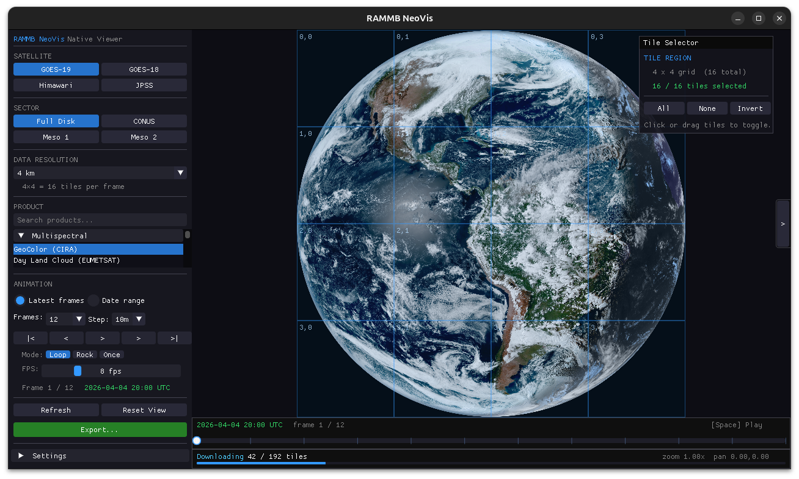

# RAMMB-NEOVIS

A native C++/OpenGL replacement for the [RAMMB Slider](https://rammb-slider.cira.colostate.edu/) satellite imagery browser. Faster, offline-capable, and built for power users who want smooth animation, export, and regional download control.



**One codebase, multiple OS targets.** Linux and macOS share the same sources and CMake entry point — platform differences (OpenGL context version, dialogs, encode backends, packaging) are isolated behind CMake/`#ifdef` helpers, not a Mac fork.

---

## Features

- **Live + archive imagery** — Latest-N frames mode or full date/time range picker with API-populated time dropdowns
- **Smooth animation** — Loop, rock, and once modes with adjustable FPS
- **Tile region selector** — Interactive grid overlay lets you download only the geographic region you care about
- **Pause/resume downloads** — Stop background tile downloads without losing loaded frames
- **Scene tabs** — Save and switch between multiple satellite/sector/product configurations, browser-tab style
- **Export** — MP4 (hardware H.264 when available, else libx264), animated GIF, or PNG sequence with a draggable crop box
  - Output resolution auto-matches the crop aspect ratio (Low / Medium / High / Custom presets)
- **Notifications** — Toast popups for load status, tile failures, and export completion
- **Settings** — VSync, memory cache limit, auto-reload timer, per-scene naming

---

## Supported satellites and sectors

| Satellite | Sectors |
|-----------|---------|
| GOES-19   | Full Disk, CONUS, Mesoscale 1 & 2 |
| GOES-18   | Full Disk, CONUS, Mesoscale 1 & 2 |
| Himawari  | Full Disk |
| JPSS      | Various |

Products include GeoColor, individual ABI bands, derived products (sandwich RGB, fire temperature, etc.), and more — all sourced from the RAMMB Slider API.

---

## Building from source

### Requirements

| | Linux | macOS |
|---|--------|--------|
| OS | Ubuntu 22.04 / 24.04 tested (other distros OK) | Recent macOS with Homebrew |
| Compiler | GCC 13+ or Clang 16+ (`std::format`) | Apple Clang (recent Xcode) |
| CMake | 3.24+ | 3.24+ |
| GPU / GL | OpenGL **4.5** core | OpenGL **4.1** core (system max) |

> **macOS OpenGL note:** Apple deprecated OpenGL (still present and GPU-accelerated via Apple’s GL→Metal path). This project uses OpenGL 4.1 + forward-compat on Mac for a shared renderer with Linux. A Metal backend is optional future work in the same repo — not a separate product.

### Install dependencies

**Ubuntu / Debian**

```bash
sudo apt install \
  build-essential cmake \
  libglfw3-dev libglew-dev libglm-dev \
  libcurl4-openssl-dev \
  libavcodec-dev libavformat-dev libavutil-dev libswscale-dev \
  nlohmann-json3-dev \
  libsqlite3-dev \
  zenity          # used by portable file dialogs on Linux
```

**macOS (Homebrew)**

```bash
brew install cmake glfw glew glm curl ffmpeg nlohmann-json sqlite pkg-config
```

ImGui, stb, and portable-file-dialogs are fetched automatically by CMake on first configure (needs network).

### Clone and build

Same commands on both platforms (adjust `-j` as you like):

```bash
git clone https://github.com/CrymsonDynamo/RAMMB-NEOVIS.git
cd RAMMB-NEOVIS
cmake -B build -DCMAKE_BUILD_TYPE=Release
cmake --build build -j$(nproc)          # macOS: $(sysctl -n hw.ncpu)
./build/rammb-neovis
```

Shaders are copied next to the binary after build.

### Optional macOS `.app` bundle

Default build is a CLI binary next to `shaders/` (same mental model as Linux). To produce a `.app`:

```bash
cmake -B build -DCMAKE_BUILD_TYPE=Release -DRAMMB_MACOSX_BUNDLE=ON
cmake --build build -j$(sysctl -n hw.ncpu)
open build/rammb-neovis.app
```

Shaders land in `Contents/Resources/shaders`. You can also `cpack -G DragNDrop` from `build/` when the bundle option is on.

---

## Hardware acceleration

| Concern | Linux | macOS |
|---------|-------|-------|
| Display | OpenGL 4.5 | OpenGL 4.1 + forward compat |
| MP4 encode (prefer HW) | `h264_nvenc` → `libx264` | `h264_videotoolbox` → `libx264` |

The export panel checkbox is **Prefer hardware encoder** — not NVENC-specific. If the HW encoder is missing or fails to open, export falls through to software H.264.

---

## Controls

| Input | Action |
|-------|--------|
| Drag (viewport) | Pan |
| Scroll wheel | Zoom |
| Space | Play / Pause |
| ← / → | Step one frame |
| Home | Reset pan and zoom |
| R | Reload current source |
| Ctrl+S / Cmd+S | Save scene |
| Ctrl+Shift+S / Cmd+Shift+S | Save scene as |
| Ctrl+O / Cmd+O | Open scene |
| Esc | Quit |

---

## Export

1. Click **Export...** in the sidebar
2. Drag the blue crop box corners or body to select your region — it snaps to world coordinates so it's frame-consistent
3. Pick a format (MP4 / GIF / PNG sequence), resolution preset, and output path
4. Click **Export** — progress is shown in the panel; the export runs in a background thread

For MP4, enable **Prefer hardware encoder** to try NVENC (Linux) or VideoToolbox (macOS). Falls back to libx264 automatically.

---

## Tile region selector

Click the **`<`** tab on the right edge of the viewport to open the tile region selector. Each cell in the overlay corresponds to one tile at the current data zoom level. Click or drag to toggle tiles on/off. Only selected tiles are downloaded, and the progress counter reflects the selected count.

---

## Scene tabs

The bar at the top of the window works like browser tabs — each scene stores its own satellite, sector, product, date range, and zoom level. Use **+** to create a new scene, **×** to close one. Scene names can be edited in the Settings panel (gear icon, top-right).

---

## Project structure

```
src/
  app.cpp / app.hpp          — Main application loop, GLFW callbacks
  platform.cpp / .hpp        — OS/GL helpers (context, dialogs, paths, mods)
  animation.cpp / .hpp       — Frame timing and playback modes
  tile_manager.cpp / .hpp    — Tile download, caching, and selection mask
  thread_pool.hpp            — Work queue with pause/resume
  satellite_config.hpp       — Satellite/sector/product definitions
  renderer/                  — OpenGL tile renderer
  network/                   — HTTP client (libcurl wrapper)
  export/                    — FFmpeg-based MP4/GIF/PNG exporter
  ui/
    sidebar.cpp              — Left panel (source, animation, date range)
    scene_bar.cpp            — Top tab bar and settings panel
    timeline.cpp             — Bottom scrubber
    export_panel.cpp         — Export panel + crop overlay
    tools_panel.cpp          — Right-side tile region selector overlay
    notifications.hpp        — Toast notification system
shaders/
  tile.vert / tile.frag      — GLSL 410 shaders for tile rendering
```

---

## License

MIT — see [LICENSE](LICENSE)

Data is sourced from [RAMMB Slider](https://rammb-slider.cira.colostate.edu/) (Colorado State University / CIRA). All satellite imagery is property of NOAA/NASA. This tool is for research and educational use.
